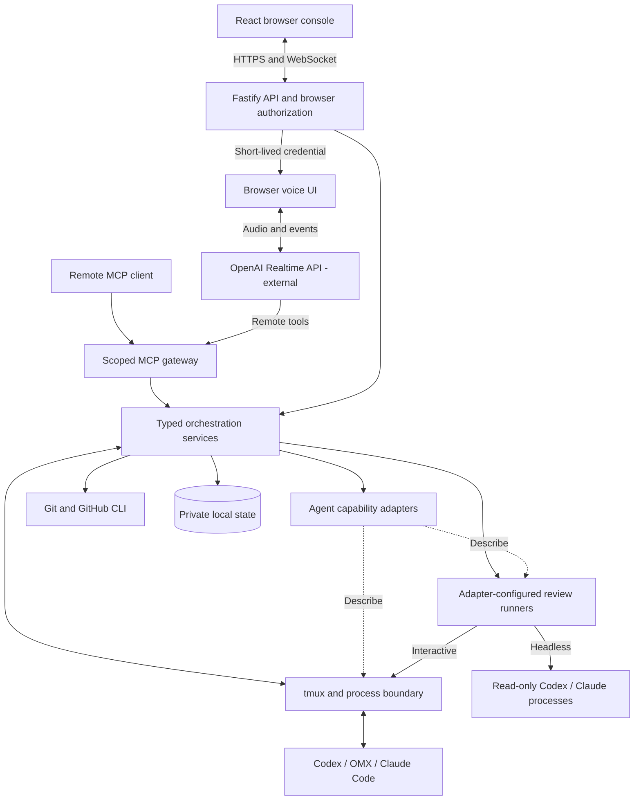

<h1 align="center">Remote Agent Console</h1>

  <strong>A terminal-native control plane for human-supervised AI software engineering</strong>

  Technical white paper · TypeScript · React · Fastify · tmux · MCP

  <a href="USAGE.md">Installation &amp; usage</a> ·
  <a href="docs/adr">Architecture decisions</a> ·
  <a href="SECURITY.md">Security model</a> ·
  <a href="CONTRIBUTING.md">Contributing</a>

## Abstract

AI coding agents can generate changes, execute tools, and reason over large
repositories, but concurrent agents introduce an orchestration problem that a chat
interface alone does not solve. An operator must know which process owns a task,
which checkout it can affect, whether it is working or awaiting input, and whether
a queued instruction actually reached the intended agent.

Remote Agent Console addresses this problem with a self-hosted, full-stack control
plane over terminal-native coding agents. It unifies live terminals, Git worktrees,
durable prompt queues, code review, project previews, and conversational control
without replacing the underlying CLI workflows. Codex, OMX, and Claude Code are
implemented through a capability-oriented adapter boundary; browser, MCP, and
Realtime voice interfaces reuse server-owned orchestration and policy.

The central design principle is to **keep model reasoning replaceable while making
execution effects explicit, bounded, and attributable**. The project applies that
principle from byte-level terminal transport to AI-output validation, authorization,
and deployment recovery. Its intended operating environment is one trusted
operator managing their own engineering infrastructure—not a multi-tenant service.

## 1. Problem statement and design constraints

The difficult part of supervising several coding agents is not starting more
processes. It is preserving identity, intent, and context as those processes and
their working directories change independently of the browser.

| Constraint | Engineering consequence |
| --- | --- |
| Agents already run in terminals | Integrate with tmux and the CLI's own conversations rather than inventing a replacement runtime. |
| Several agents can share a checkout | Bind prompts and history to the exact agent, not merely the worktree. |
| Browsers disconnect; processes continue | Separate execution lifetime from presentation lifetime and support reconnect and recovery. |
| Terminal output and AI replies are untrusted inputs | Bound parsers and buffers; validate structured results before publication. |
| Browser actions can exercise host-account privileges | Revalidate identity and authority immediately before side effects. |
| A single operator maintains the installation | Prefer inspectable local state and portable deployment over distributed infrastructure. |

These constraints favor a focused developer-infrastructure system: a durable
execution substrate, explicit domain identities, a responsive supervision surface,
and deterministic boundaries around probabilistic AI components.

## 2. System architecture

The server owns discovery, target resolution, prompt delivery, persistence, and
integrations. The React client owns presentation and interaction, including xterm
rendering, responsive panels, selection, reconnect behavior, and permission UI.
Agent adapters describe CLI-specific behavior; a shared runtime layer performs
terminal and process effects.

The domain model deliberately distinguishes objects that have different lifetimes:

| Entity | Identity and responsibility |
| --- | --- |
| **Project** | Operator-configured repository or directory with trusted commands and settings. |
| **Worktree** | Git-discovered checkout; repository identity is resolved through its common Git directory. |
| **Place** | A worktree, directory project, or scratch folder that anchors navigation. |
| **Workspace** | The panels at a Place, with pane membership anchored by a marked tmux session. |
| **Agent** | A live, recognized process tree in a specific tmux pane. |
| **Conversation** | The agent CLI's resumable transcript, independent of the live pane. |

This separation prevents a renamed branch, a shell's `cd`, or a replaced process
from silently becoming a different authorization or delivery target. Worktrees
come from Git rather than duplicated configuration, while workspace membership
comes from tmux session metadata rather than repeatedly inferred working
directories. [ADR 0003](docs/adr/0003-worktrees-are-discovered-and-state-is-keyed-by-path.md)
and [ADR 0009](docs/adr/0009-a-workspace-is-its-tmux-session.md) record the identity
model and its evolution.

## 3. Runtime integration without duplicated effects

### 3.1 Adapters describe; the console acts

An adapter recognizes a CLI's processes, composes launch arguments, prepares
prompt submission, interprets attention state, and exposes supported conversation
or review operations. It does not independently implement tmux input, socket
selection, or process discovery.

Capabilities are derived from implemented interfaces rather than optimistic flags.
The browser can distinguish an agent that supports inline questions or conversation
naming from one that does not. The registry is a closed, type-checked set—not an
unrestricted runtime plugin loader—and shared fixture tests exercise real process
identities, prompts, and terminal captures.

The payoff is a single place to enforce target validation, input ordering, and
bracketed-paste behavior as agent support expands. Filesystem-dependent readers
remain behind injectable roots so their parsing can be tested independently of a
live operator environment. See the [adapter contract](apps/server/src/adapters/types.ts),
[registered implementations](apps/server/src/adapters/registry.ts), and
[ADR 0002](docs/adr/0002-adapters-describe-the-console-acts.md).

### 3.2 Reported state before heuristics

An agent's attention state is not assumed to be a reliable property of its screen
title. Where lifecycle hooks are available, the agent reports state through tmux
pane options. That report is valid only while the reporting agent remains alive;
inline-question detection and adapter-specific title inference provide fallback
signals.

This preserves compatibility with hand-started CLIs while making uncertainty
explicit. An adapter without a reliable title signal does not invent one.
[ADR 0001](docs/adr/0001-agent-state-via-tmux-pane-options.md) explains why the
reporting channel uses tmux metadata instead of introducing a credentialed hook
endpoint or another state-file convention.

## 4. The terminal data plane

The live view is a streaming transport, not a repeated screenshot of terminal text.
One lazily created tmux control-mode client serves the viewers of a session and is
released when no viewers remain. Raw pane bytes travel to xterm over binary
WebSocket frames; typed JSON frames carry sizing, metadata, acknowledgments, and
recovery events.

Several details make this more than a WebSocket wrapper:

- **Byte fidelity.** Control-protocol octal escapes are decoded before UTF-8
  interpretation, preserving output split across transport chunks.
- **Ordered initialization.** A captured seed establishes terminal state before
  subsequent live bytes are applied; reconnects rebuild the view rather than
  appending to an unknown screen.
- **Backpressure recovery.** A slow viewer acknowledges consumed bytes. When it
  falls behind, the server drops output for that viewer and later reseeds instead
  of indefinitely buffering or pausing the shared tmux pipe.
- **Viewport arbitration.** Browser size claims yield to smaller attached terminals;
  the UI conforms to the actual size tmux grants.
- **Bounded failure.** Command correlation, reply caps, timeouts, and connection
  teardown turn a stalled control client into a reconnect rather than a permanent
  frozen view.
- **Browser-side terminal policy.** Escape sequences that could generate implicit
  input replies or excessive parser work are intercepted. Rendering raw program
  output is not treated as permission to trust its control sequences.

The implementation spans the [tmux control client](apps/server/src/tmux/control.ts),
[protocol parser](apps/server/src/tmux/control-protocol.ts),
[browser wire contract](apps/web/src/pane-stream.ts), and
[xterm safety layer](apps/web/src/pane-safety.ts).
[ADR 0008](docs/adr/0008-pane-output-streams-over-one-control-mode-client-per-session.md)
records the trade study and incremental migration from capture polling to streaming.
Dashboard discovery remains a separate observation path; display caches do not
replace fresh lifecycle checks.

## 5. Durable intent across an unreliable terminal boundary

Sending a prompt to a TUI is not equivalent to completing an HTTP transaction.
A successful paste can leave text in the composer without submitting it; a pane
can be replaced between discovery and input; an idle sibling can be mistaken for
the intended agent. Remote Agent Console treats delivery as a staged workflow
rather than assuming that sending keystrokes proves acceptance.

The prompt service persists queued intent, serializes mutations, revalidates the
socket/pane/process target, and uses adapter-specific composer observations and
transcript receipts where available. Completion is correlated with a pre-submit
baseline instead of accepting any recently visible assistant response. Recovery
clears drafts only when the console can establish ownership.

Queue and history ownership is **per agent**, including when multiple agents share
a worktree. A managed restart hands state to the replacement agent. If an agent
disappears beyond a discovery grace period, undelivered prompts are preserved as
operator-visible Notes rather than offered to an arbitrary sibling. Queue, history,
and note stores use bounded records, private file permissions, and atomic file
replacement.

This is recoverable local coordination, not a claim of distributed exactly-once
execution. The important contract is that uncertainty is handled explicitly and
undelivered intent has a recovery path. The [prompt service](apps/server/src/prompts/service.ts)
and [ADR 0012](docs/adr/0012-queued-prompts-and-history-belong-to-the-agent.md) describe
the delivery and ownership boundaries.

## 6. AI as a constrained systems component

### 6.1 Code understanding with deterministic acceptance criteria

The review subsystem separates two jobs: a **Review tour** explains related changes;
an optional **Code review** proposes findings for human triage. Neither is treated
as an authoritative correctness verdict.

The server captures a bounded Git comparison, assigns content-derived change
identifiers, and owns the response schema and semantic rules. A tour must account
for the expected changes rather than silently omitting inconvenient files. Tour
output is parsed and validated, then checked against fresh worktree identity and a
comparison fingerprint before publication. Code review findings can finish against
the stored comparison after the worktree changes; content-derived IDs constrain
their anchors, and the tour's stale state signals when regeneration is needed.

Configured Codex or Claude runs can execute headlessly or in visible terminal panes.
Review conversations are retained so questions can resume the original reviewer's
context. Turns on the same conversation are serialized, read-only restrictions
are reapplied on resume, and pending work and retained threads are bounded.

The engineering boundary is deliberate: prompts guide the model; schemas,
capability restrictions, freshness checks, and human triage govern what the
application accepts. See the [review contracts](apps/server/src/review-tour/contracts.ts),
[review service](apps/server/src/review-tour/service.ts), and
[resumable-run decision](docs/adr/0013-review-runs-are-resumable-and-ask-follows-the-run-mode.md).

### 6.2 One orchestration core, multiple AI interfaces

Remote MCP and Realtime voice expose the same typed orchestration operations
instead of introducing separate execution backends. The shared gateway validates
tool arguments, exact scopes, deployment feature gates, mutation authorization,
and idempotency request IDs, and produces redacted audit records. Integrations are
optional and disabled by default; they do not expose an arbitrary shell or raw
terminal-input tool.

Voice clients receive short-lived Realtime credentials rather than the server's
standard API key. Voice audio and session events flow to OpenAI's Realtime service,
which invokes the console's MCP endpoint. Mutations additionally depend on an
active browser voice-control gate. Cross-instance requests use signed, timestamped
delegation; the originating OAuth bearer is not forwarded, and the destination
rechecks its own policy.
Interrupted mutation effects are recorded as unknown outcomes rather than blindly
replayed.

The [orchestration contracts](apps/server/src/orchestration/contracts.ts),
[MCP gateway](apps/server/src/integrations/mcp/gateway.ts), and
[integration reference](docs/integrations.md) show how conversational interfaces
reuse—not bypass—the application's authority boundaries.

## 7. Security and operational safety

The threat model starts with an explicit limitation: a controlled console can act
with the Unix account's privileges. Authentication does not turn that account into
a sandbox or make the service suitable for untrusted tenants.

Within the single-operator boundary, defenses are layered:

| Boundary | Implemented controls |
| --- | --- |
| Browser admission | Argon2id password verification, signed HttpOnly sessions, rate limiting, canonical Host checks, and HTTPS deployment expectations. |
| Browser mutations | Canonical Origin and CSRF validation plus an explicit single-controller lease. |
| WebSocket admission | Short-lived, single-use tickets bound to the session, capability kind, and target. |
| Agent prompt and lifecycle effects | Fresh target resolution, mutation serialization, and rejection of replaced or drifted identities. |
| MCP and Realtime tools | Scoped typed operations, deployment gates, redaction, idempotency, and auditing. |
| Resource consumption | Bounded request bodies, frames, retained state, file operations, and model-run output. |

Operational safety extends to configuration changes. The settings apply/recovery
path checks the source/runtime baseline, publishes files atomically, and requires
a newly booted healthy listener. An independent watchdog provides a recovery path
when a restart fails. This matters particularly for a remote administration tool:
a configuration UI must not assume that the process applying its settings will
survive to repair them.

The [security policy](SECURITY.md), [authorization code](apps/server/src/auth), and
[settings recovery implementation](scripts/settings) document these boundaries.

## 8. Full-stack product and deployment engineering

The browser is a supervision workspace rather than a terminal embedded in a page.
It brings agent output, notes, code comparisons, project previews, files, stack
processes, and GitHub state into a shared context. Desktop panels and mobile
navigation serve the same workflows, including prompt queues, attachments,
structured questions, voice, and resumable review threads.

The technical work crosses the UI/API boundary: terminal selection and touch
scrolling, keyboard routing, stale async-result handling, reconnection, file
operation limits, permission mediation for managed previews, and server-persisted
state. These concerns are implemented in React/TypeScript over a Fastify server
with runtime-validated contracts, not delegated to an agent framework.

Deployment supports native execution, systemd, and Docker Compose. The default
Compose topology is scratch-only; host tmux access and an external tunnel are
explicit additions. Installation-specific paths, mounts, origins, and credentials
stay outside tracked configuration. Local JSON persistence keeps the deployment
inspectable without requiring a database or message broker; it is not intended to
provide multi-writer coordination or high availability.

Installation and operating procedures live in **[USAGE.md](USAGE.md)**.

## 9. Verification strategy

The repository tests boundaries at several levels rather than relying solely on
mocked happy paths:

| Layer | Representative evidence |
| --- | --- |
| Agent contracts | [Adapter fixtures and contract tests](apps/server/test/adapters) for process recognition, state, questions, and conversations. |
| Authorization | [Authentication](apps/server/test/auth.test.ts), [bounded authorization state](apps/server/test/bounds.test.ts), and [integration policy](apps/server/test/integration-policy.test.ts) tests. |
| Terminal transport | [Control-protocol tests](apps/server/test/control-protocol.test.ts) and [real tmux/WebSocket tests](apps/server/test/pane-socket-tmux.test.ts). |
| Prompt recovery | [Submission recovery](apps/server/test/prompt-submit-recovery.test.ts) and [queue behavior](apps/server/test/queued-prompts.test.ts) tests. |
| AI result handling | [Review generation](apps/server/test/review-tour-generator.test.ts) and [review-run](apps/server/test/review-runs.test.ts) tests. |
| Rendered UX | Playwright specs for [streamed terminals](apps/web/e2e/streamed-terminal.spec.ts), [mobile layouts](apps/web/e2e/responsive-layout.spec.ts), and [prompt queues](apps/web/e2e/queued-prompts.spec.ts). |
| Operations | [Deployment portability](apps/server/test/portable-deployment.test.ts) and [settings/recovery tests](scripts/settings). |

Type checking and builds cover both applications. Server tests use Vitest; browser
behavior uses Playwright, including scripted transport fixtures and real rendered
xterm interactions. These are inspectable verification assets, not a claim of
exhaustive coverage, independently audited security, or measured production-scale
throughput. Validation commands are in [USAGE.md](USAGE.md#development).

## 10. Tradeoffs and limits

- **Linux and tmux are intentional dependencies.** They preserve existing agent
  workflows and execution lifetime at the cost of platform portability.
- **CLI compatibility remains a maintenance surface.** Hooks and native transcripts
  improve observation, but TUI parsing and process inspection can still degrade
  when upstream agents change or the host restricts `/proc` access.
- **Local persistence favors operational simplicity.** Atomic replacement does not
  make several files a distributed transaction or enable horizontal scaling.
- **Single-operator control is not tenant isolation.** Multiple devices do not imply
  multiple mutually untrusted users.
- **AI assistance is not a verification oracle.** Read-only review runs, validated
  structure, and fresh comparisons constrain behavior; they do not prove that an
  explanation is correct or that a patch is safe to merge.

The architectural contribution is the integration: terminal execution, durable
intent, identity-aware authorization, bounded AI workflows, and a usable full-stack
supervision surface. The project treats AI fluency as an engineering discipline—
understanding where models add leverage and building explicit systems around the
places where they cannot provide guarantees.

## Further reading

- [Installation, configuration, controls, and development](USAGE.md)
- [Architecture decision records](docs/adr)
- [Domain vocabulary](CONTEXT.md)
- [Setup and capability reference](docs/setup.md)
- [MCP, Realtime voice, and federation](docs/integrations.md)
- [Security policy](SECURITY.md)
- [Contributing](CONTRIBUTING.md)
